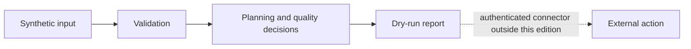

# Automation architecture

Four dependency-free modules expose decision logic separately from external actions:

The modules were selected from a maintained private automation workspace. Operational comments were removed. Tests and examples were written from scratch with synthetic data; private prompts, accounts, records and configuration were not imported.

- Approval commands distinguish explicit approval, questions and revision. A real connector must independently verify the actor, permissions and pending action. The parser does not send messages.
- Editorial planning proposes moves, missing slots and surplus content. The example pattern uses a fixed UTC offset; applications with daylight-saving time need a timezone-aware scheduling layer. No schedule is changed by the example.
- Site quality checks inspect supplied HTML and sitemap statuses. The offline demo does not call the optional live audit function. A service exposing URL fetching needs its own destination allowlist and network protections.
- Article quality checks normalize slugs and report metadata/content issues. These heuristics do not guarantee search ranking or AI citation.

This repository demonstrates reusable components, not a complete hosted agent service or a reproduction of the private runtime.
